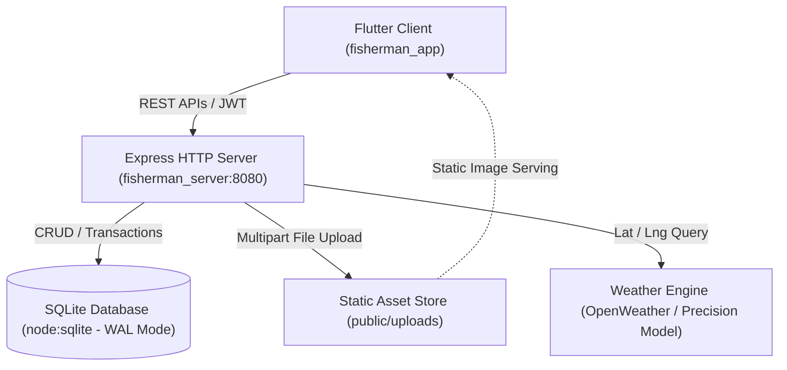

# 🏛️ Architecture & Component Blueprint

This document details the software architecture, design patterns, and interaction paradigms of the FisherMan project.

---

## 1. High-Level System Architecture



---

## 2. Flutter Client Layered Structure

The mobile app follows a clean, reactive Provider architecture:

```
fisherman_app/lib/
├── core/
│   ├── constants/
│   │   ├── app_colors.dart        # Unified brand & dark/light palettes
│   │   └── app_constants.dart     # Default URLs, water types, fish lists
│   ├── network/
│   │   ├── api_client.dart        # Singleton HTTP client with auto-refresh & token handling
│   │   └── api_endpoints.dart     # Centralized URL route catalog
│   └── theme/
│       └── app_theme.dart         # Material 3 light & dark ThemeData
├── models/
│   ├── user_model.dart            # UserModel, UserStats, UserBadge
│   ├── spot_model.dart            # SpotModel, SpotReview
│   ├── catch_model.dart           # CatchModel, CatchComment
│   └── weather_model.dart         # WeatherModel, HourlyForecast, DailyForecast
├── providers/
│   ├── auth_provider.dart         # User auth, profile, guest mode, token cache
│   ├── spots_provider.dart        # Spots listing, filtering, create, delete, favorite
│   ├── catches_provider.dart      # Feed stream, offset pagination, post, like, comment
│   └── weather_provider.dart      # Weather & barometric index provider
└── views/
    ├── auth/                      # Login / Register tabs
    ├── map/                       # Interactive OSM map, add-spot sheet, spot detail
    ├── feed/                      # Community catch feed, catch detail, comment replies
    ├── publish/                   # Catch publish flow with image picker & preview
    ├── notifications/             # Notification center with unread count
    ├── search/                    # Unified multi-category search
    ├── profile/                   # Self profile, stats charts, other users, follow list
    └── main_navigation.dart       # BottomNavigationBar shell with badge counts
```

### State Management Guidelines
- `Provider.of<T>(context)` or `context.read<T>()` / `context.watch<T>()` are used.
- Optimistic UI updates: Likes and Favorites toggle locally before API responses resolve to ensure zero perceived latency.
- Pagination: `CatchesProvider` maintains `catches` list and triggers offset-based incremental fetches via scroll listener.

---

## 3. Backend Express Services

The Node.js server is structured as follows:

```
fisherman_server/src/
├── app.js                         # Express routing, middleware, CORS, JSON limit
├── server.js                      # HTTP server listener (port 8080)
├── db.js                          # SQLite schema initialization, indices & seed data
├── middleware/
│   └── auth.js                    # authenticate, optionalAuth, generateToken, verifyRefreshToken
└── controllers/
    ├── auth.js                    # register, login, refresh, getMe, updateProfile, getUserProfile
    ├── spots.js                   # listSpots, getSpotDetail, createSpot, deleteSpot, toggleFavorite
    ├── catches.js                 # listCatches, createCatch, deleteCatch, toggleLike, addComment
    ├── reviews.js                 # addReview, listReviews (1-5 stars & comments)
    ├── follows.js                 # toggleFollow, getFollowers, getFollowing
    ├── notifications.js           # listNotifications, getUnreadCount, markAllRead
    ├── search.js                  # Unified keyword search across spots, catches, users
    ├── stats.js                   # Platform totals, angler leaderboard, my monthly charts
    └── weather.js                 # Barometric pressure algorithm & 3-day forecast
```
