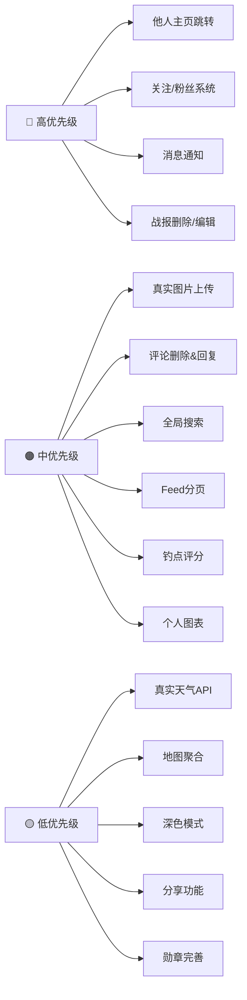

# 🎣 FisherMan — 待开发功能 & 优化清单

> 基于代码全面分析生成，覆盖 Flutter App + Node.js 后端。

---

## 🔴 高优先级（核心社交功能缺失）

### 1. 他人主页 / 用户资料页
**现状**：后端 `GET /api/users/:id` 已实现，但 Flutter 端**完全没有跳转入口**。
Feed 和评论里的头像/昵称是静态文本，点击无任何反应。

**需要做：**
- 新建 `views/profile/user_profile_screen.dart`（他人主页，只读）
- 展示：头像、昵称、钓龄、个人简介、勋章、统计数据
- 展示该用户发布的战报列表（调用 `GET /api/catches?userId=xxx`）
- 展示该用户创建的钓点列表
- Feed 卡片头像、评论头像、钓点创建者头像 → 点击跳转

---

### 2. 关注 / 粉丝系统（Follow）
**现状**：数据库无 `follows` 表，后端无相关接口。

**需要做：**
- 数据库新增 `follows` 表（`follower_id`, `following_id`）
- `POST /api/users/:id/follow` — 关注/取关切换
- `GET /api/users/:id/followers` / `following`
- 他人主页显示关注数、粉丝数、关注按钮
- 个人主页显示自己的关注/粉丝入口

---

### 3. 消息通知系统
**现状**：完全没有通知机制。用户无法感知"有人点赞/评论了我的战报"。

**需要做：**
- 数据库新增 `notifications` 表（type: like / comment / follow / system）
- 点赞、评论、关注等操作时写入通知记录
- `GET /api/notifications`（分页，已读/未读）
- `PUT /api/notifications/read`（批量标记已读）
- Flutter：主导航栏图标显示红点未读数
- 新建 `views/notifications/notifications_screen.dart`

---

### 4. 战报删除 / 编辑功能
**现状**：`catches` 控制器无 DELETE 和 PUT 接口；用户发布后无法管理自己的内容。

**需要做：**
- `DELETE /api/catches/:id`（权限校验：只能删自己的）
- `PUT /api/catches/:id`（更新备注、图片等）
- 我的战报列表长按 → 弹出编辑/删除菜单
- `DELETE /api/spots/:id`（钓点也同理）

---

## 🟠 中优先级（体验提升）

### 5. 图片真实上传（当前是 URL 字符串）
**现状**：后端 `POST /api/upload` 已实现，但 Flutter 发布战报时 `photoUrl` 是手动填 URL 字符串，没有调用上传接口。

**需要做：**
- `publish_catch_screen.dart` 接入 `image_picker` 插件选图
- 调用 `POST /api/upload` 上传后拿回真实 URL
- 显示上传进度条

---

### 6. 评论删除 & 二级回复
**现状**：评论只能添加，无法删除；且是平铺式，没有回复功能。

**需要做：**
- `DELETE /api/catches/:id/comments/:commentId`
- `comments` 表新增 `parent_id` 字段支持嵌套回复
- Flutter 评论列表支持长按删除（自己的评论）
- 支持"回复@某人"功能

---

### 7. 搜索功能
**现状**：Feed 页无搜索入口；钓点地图有关键词搜索但仅限钓点。

**需要做：**
- 新建 `views/search/search_screen.dart`
- 搜索战报（鱼种、用户昵称）
- 搜索钓点（名称、地址）
- 搜索用户（昵称）
- `GET /api/search?q=xxx&type=catches|spots|users`

---

### 8. Feed 分页加载（当前是硬限 50 条）
**现状**：`GET /api/catches` 硬写 `limit=50`，无分页机制，用户越多性能越差。

**需要做：**
- 后端支持 `page` / `offset` + `limit` 分页
- Flutter 用 `ScrollController` 监听到底触发下一页加载
- 加载状态指示器（骨架屏 or loading spinner）

---

### 9. 钓点评价 / 评分
**现状**：钓点只有收藏，没有评分和评论机制，用户无法评价钓点质量。

**需要做：**
- 数据库新增 `spot_reviews` 表（`rating` 1~5星、`content`、`user_id`）
- `POST /api/spots/:id/reviews`
- `GET /api/spots/:id/reviews`（分页）
- `spots.avg_rating` 字段（或动态计算）
- Flutter 钓点详情页展示评分、评价列表

---

### 10. 个人统计图表
**现状**：个人页只显示数字统计，缺乏数据可视化。

**需要做：**
- 月度钓获趋势折线图（按月统计 catch 数量 & 总重量）
- 鱼种分布饼图
- 引入 `fl_chart` 插件
- 后端 `GET /api/stats/my` 返回按月分组的数据

---

## 🟡 低优先级（锦上添花）

### 11. 天气预报优化
**现状**：`weather.js` 控制器返回的是**模拟数据**（写死的随机数），不是真实天气。

**需要做：**
- 接入真实天气 API（OpenWeatherMap 或 和风天气）
- 基于用户当前位置坐标查询
- 未来 3 天钓鱼指数预测

---

### 12. 地图聚合标记（Cluster）
**现状**：钓点多时地图上所有 marker 都显示，密集区域严重重叠。

**需要做：**
- 引入 `flutter_map_marker_cluster` 插件
- 缩放级别低时合并附近标记为数字气泡

---

### 13. 深色模式
**现状**：`app_theme.dart` 只定义了亮色主题，没有暗色主题。

**需要做：**
- 补充 `ThemeData.dark()`
- 跟随系统自动切换 or 手动切换开关

---

### 14. 分享功能
**现状**：战报和钓点无任何分享入口。

**需要做：**
- 生成战报分享图（截图 + 水印）
- 调用系统 `Share` 接口分享到微信/微博
- 引入 `share_plus` 插件

---

### 15. 勋章系统完善
**现状**：徽章逻辑在后端写死了 4 个，但前端 profile 页只展示，没有详情说明。

**需要做：**
- 增加更多勋章类型（连续钓鱼天数、首次某鱼种、等）
- 勋章详情弹窗（点击查看获得条件）
- 未解锁勋章灰色显示（进度条提示）

---

## 🔧 技术债 & 架构优化

| 问题 | 现状 | 建议 |
|------|------|------|
| 热门鱼种数据 | `stats.js` 里写死假数据 | 改为从 `catches` 表动态统计 |
| 错误处理 | Flutter 端 API 错误只用 SnackBar，体验粗糙 | 封装统一错误处理 + Retry 机制 |
| Token 刷新 | JWT 到期后无 refresh token 机制，用户会被强制登出 | 实现 refresh token 流程 |
| 评论数/点赞数 | 存为冗余字段手动维护，容易不一致 | 改为视图或触发器维护 |
| 图片缓存 | `Image.network` 无缓存策略 | 引入 `cached_network_image` |
| 输入校验 | 后端部分接口校验不完整（如 `lengthCm` 可以为负数） | 加 Joi/Zod 校验层 |

---

## 📋 优先级总览

